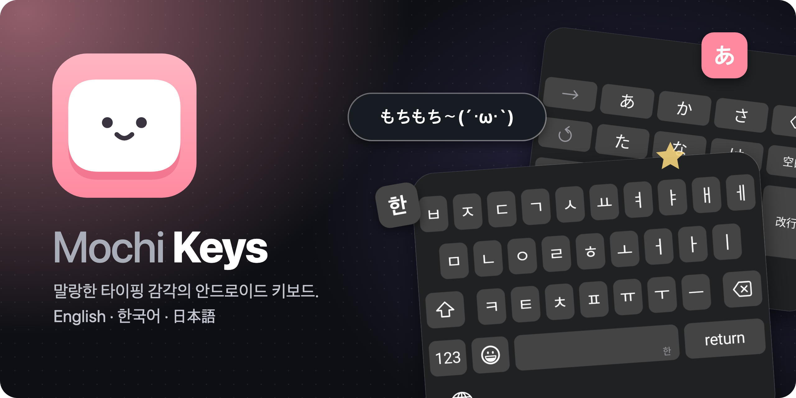
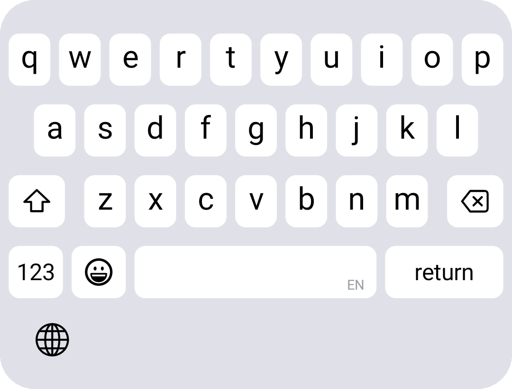
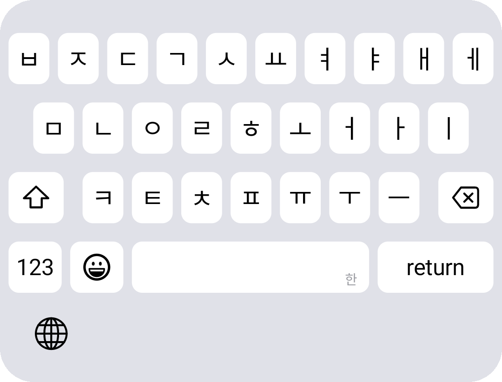
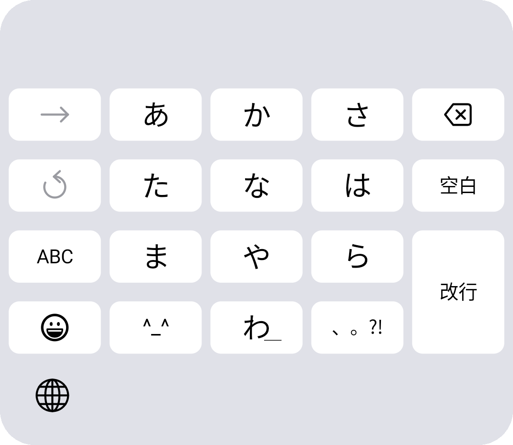

  

# Mochi Keys

말랑한 타이핑 감각의 안드로이드 키보드입니다.

누르는 순간 키가 톡 올라오고, 손을 떼면 입력됩니다. 길게 누르면 다른 글자가 나오고, 스페이스를 누른 채 밀면 커서가 움직입니다.

> 아직 개발 초기입니다. 버그가 있을 수 있습니다.

  
  
  

## 설치

  
  &nbsp;&nbsp;&nbsp;
  

  
  
  
  

- **Obtainium** — 폰에서 위 버튼을 누르면 [Obtainium](https://github.com/ImranR98/Obtainium)에 바로 추가됩니다. 새 버전이 나오면 업데이트를 받습니다.
- **직접 설치** — Releases에서 APK를 받아 설치합니다.

Android 11 이상에서 동작합니다. APK는 CPU별로 나뉘어 있고, 대부분의 폰은 `arm64-v8a`입니다. Obtainium은 기기에 맞는 것을 알아서 고릅니다. APK는 APK Signature Scheme v2로 서명됩니다.

## 키보드 켜기

1. 앱 목록에서 **Mochi Keys 설정**을 엽니다.
2. **키보드 켜기**를 눌러 시스템 설정에서 Mochi Keys를 켭니다.
3. 돌아와서 **기본으로 선택**을 누르고 Mochi Keys를 고릅니다.

맨 위 카드가 "사용 중"으로 바뀌면 끝입니다.

## 쓸 수 있는 언어

- **English** — QWERTY
- **한국어** — 두벌식
- **日本語** — かな 플릭. 한자 변환과 예측 후보를 지원합니다.

왼쪽 아래 지구본을 누르면 다음 언어로 바뀌고, 길게 누르면 목록에서 고를 수 있습니다. 쓰지 않는 언어는 설정에서 끌 수 있습니다.

## 이런 걸 할 수 있어요

- **길게 눌러 다른 글자** — `e`를 길게 누르면 `è é ê`, `ㅂ`을 길게 누르면 `ㅃ`
- **스페이스로 커서 옮기기** — 스페이스를 길게 누른 채 좌우로 밀기
- **일본어 플릭** — 키를 누른 채 상하좌우로 밀기. 누르고 있으면 방향 안내가 뜹니다.
- **이모지** — `123` 옆 키. 위쪽 검색 칸에서 영어·한국어·일본어로 찾을 수 있습니다.
- **다크 모드** — 기기 설정을 따라갑니다.
- **소리와 진동** — 키 누르는 소리는 기본으로 꺼져 있고, 설정에서 켤 수 있습니다.

자동 수정과 단어 추천은 없습니다. 친 그대로 입력됩니다.

## 개인정보

네트워크 권한이 없습니다. 입력한 내용은 기기 밖으로 나가지 않습니다. 일본어 변환의 학습 기록도 기기 안에만 저장됩니다.

## 더 보기

- [개발 문서](docs/DEVELOPMENT.md) — 빌드, 구조, 일본어 엔진, 릴리스 방법

## 라이선스

[MIT](LICENSE)

일본어 변환에 [Mozc](https://github.com/google/mozc)(BSD 3-Clause, [라이선스](third_party/mozc/LICENSE))를, 이모지 검색어에 Unicode CLDR 데이터([라이선스](third_party/cldr/LICENSE))를 사용합니다.
